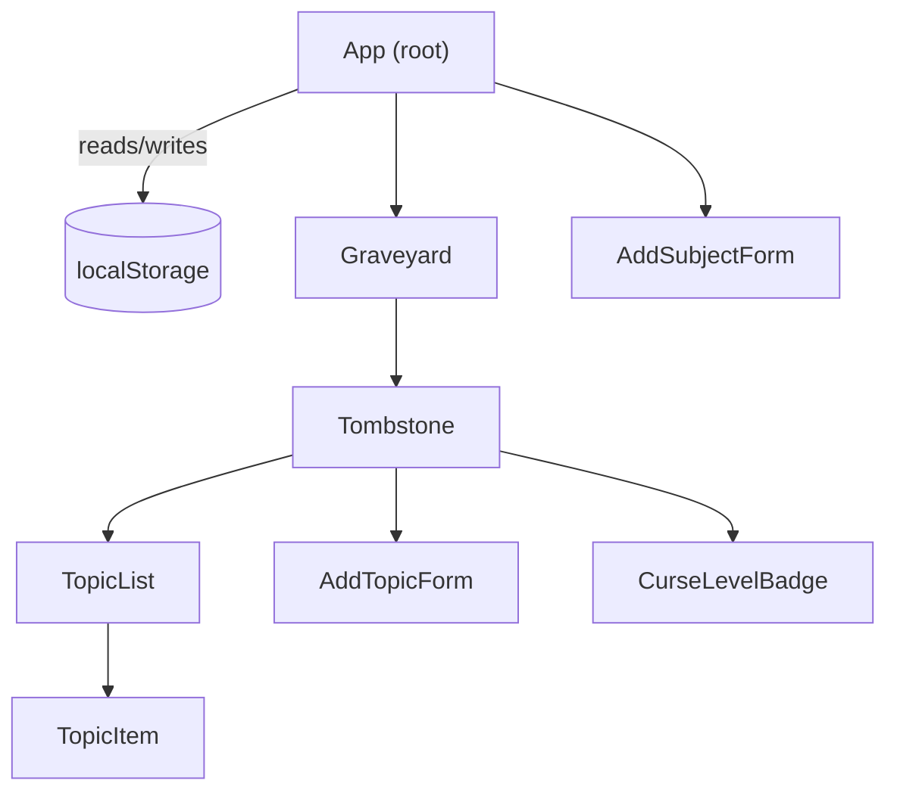

# Design Document

## Overview

Dead Week is a single-page React + Vite web application with no backend. All state lives in the browser via `localStorage`. Users create "subjects" (courses) with an exam date and a list of topics to study. Each subject is displayed as a tombstone card in a graveyard grid. A numeric "curse level" (0–100) is computed from how many topics remain unstudied and how many calendar days are left until the exam. The curse level drives four distinct visual states for each tombstone: calm, flickering, cracked, and haunted. The app is fully responsive and uses a dark Halloween aesthetic (deep purples, blacks, glowing accents, gothic display fonts).

## Architecture

The app follows a standard React component tree with a centralized state hook that owns all subject and topic data and handles all `localStorage` I/O.



**Data flow:**
1. `useSubjects` custom hook initialises state from `localStorage` on mount.
2. Every mutation (add subject, delete subject, toggle topic, add topic, remove topic) calls a handler exposed by `useSubjects`, which updates React state and immediately writes to `localStorage`.
3. `curseLevelFor(subject)` is a pure function called inside `useSubjects` after every mutation that touches topics or exam dates.
4. Derived curse levels flow down as props; no additional context or global store is needed.

## Components and Interfaces

### `App`
Root component. Renders `AddSubjectForm` and `Graveyard`. Wires all handler callbacks from `useSubjects` to child components.

### `useSubjects` (custom hook)
Owns the canonical subjects array. Exposed interface:

```ts
interface UseSubjectsResult {
  subjects: Subject[];
  addSubject(draft: SubjectDraft): void;
  deleteSubject(id: string): void;
  addTopic(subjectId: string, name: string): void;
  removeTopic(subjectId: string, topicId: string): void;
  toggleTopic(subjectId: string, topicId: string): void;
}
```

### `Graveyard`
Renders the tombstone grid. Shows an empty-state message when `subjects` is empty. Props: `subjects`, `onDelete`, `onAddTopic`, `onRemoveTopic`, `onToggleTopic`.

### `Tombstone`
Renders a single subject card. Applies a CSS class (or data attribute) corresponding to the curse-level visual state. Props: `subject`, `onDelete`, `onAddTopic`, `onRemoveTopic`, `onToggleTopic`.

```ts
type TombstoneState = 'calm' | 'flickering' | 'cracked' | 'haunted';

function getTombstoneState(curseLevel: number): TombstoneState {
  if (curseLevel <= 25) return 'calm';
  if (curseLevel <= 50) return 'flickering';
  if (curseLevel <= 75) return 'cracked';
  return 'haunted';
}
```

### `CurseLevelBadge`
Displays the numeric curse level. Always readable; positioned outside the animated overlay layer. Props: `curseLevel: number`.

### `TopicList`
Renders the list of `TopicItem` components for a subject. Props: `topics`, `onToggle`, `onRemove`.

### `TopicItem`
Renders a single topic row with a studied checkbox and a remove button. Props: `topic`, `onToggle`, `onRemove`.

### `AddSubjectForm`
Controlled form for creating a new subject. Manages local validation state. On valid submit, calls `onAdd(draft)` and resets. Props: `onAdd`.

### `AddTopicForm`
Inline form inside a Tombstone for adding a new topic to an existing subject. Validates name length and uniqueness (uniqueness check is passed via the existing topics list). Props: `existingTopics: string[]`, `onAdd(name: string): void`.

## Data Models

### `Subject`

```ts
interface Subject {
  id: string;          // uuid v4 generated at creation time
  name: string;        // 1–100 characters
  examDate: string;    // ISO 8601 date string, e.g. "2025-10-31"
  topics: Topic[];
  curseLevel: number;  // 0–100 integer, derived; stored for fast reads
}
```

### `Topic`

```ts
interface Topic {
  id: string;          // uuid v4 generated at creation time
  name: string;        // 1–100 characters, unique within a Subject
  studied: boolean;
}
```

### `SubjectDraft`
Shape submitted by `AddSubjectForm` before an id is assigned:

```ts
interface SubjectDraft {
  name: string;
  examDate: string;
  topics: string[];    // raw names; converted to Topic objects in useSubjects
}
```

### LocalStorage Schema

A single key `"dead-week:subjects"` stores the serialised `Subject[]` array as JSON. On write, the full array is serialised and written atomically. On read, the value is parsed and validated; if parsing fails the app starts with an empty array.

```ts
// Storage key
const STORAGE_KEY = "dead-week:subjects";

// Write
localStorage.setItem(STORAGE_KEY, JSON.stringify(subjects));

// Read
const raw = localStorage.getItem(STORAGE_KEY);
const subjects: Subject[] = raw ? JSON.parse(raw) : [];
```

### Curse Level Formula

```ts
/**
 * Computes the curse level for a subject.
 * Returns an integer in [0, 100].
 */
function curseLevelFor(subject: Subject): number {
  const { topics, examDate } = subject;

  // No topics → not cursed
  if (topics.length === 0) return 0;

  const unstudied = topics.filter(t => !t.studied).length;

  // All studied → fully safe
  if (unstudied === 0) return 0;

  const today = new Date();
  today.setHours(0, 0, 0, 0);
  const exam = new Date(examDate);
  exam.setHours(0, 0, 0, 0);
  const daysRemaining = Math.floor((exam.getTime() - today.getTime()) / 86_400_000);

  // Exam today or past + unstudied → max curse
  if (daysRemaining <= 0) return 100;

  const topicComponent = (unstudied / topics.length) * 50;
  const timeComponent = Math.max(0, Math.min(1, (30 - daysRemaining) / 30)) * 50;

  return Math.round(topicComponent + timeComponent);
}
```

## Correctness Properties

*A property is a characteristic or behavior that should hold true across all valid executions of a system — essentially, a formal statement about what the system should do. Properties serve as the bridge between human-readable specifications and machine-verifiable correctness guarantees.*

### Property 1: Curse level is always in range

*For any* subject with any combination of topics (any studied states) and any exam date, `curseLevelFor` SHALL return an integer in [0, 100].

**Validates: Requirements 3.1**

### Property 2: All-studied subjects have curse level 0

*For any* subject where every topic is marked as studied, `curseLevelFor` SHALL return 0, regardless of the exam date.

**Validates: Requirements 3.3**

### Property 3: Past-or-today exam with unstudied topics yields curse level 100

*For any* subject that has at least one unstudied topic and whose exam date is today or in the past, `curseLevelFor` SHALL return 100.

**Validates: Requirements 3.2**

### Property 4: No-topic subjects have curse level 0

*For any* subject with an empty topic list, `curseLevelFor` SHALL return 0.

**Validates: Requirements 3.7**

### Property 5: Adding a topic increases the subject's topic count by exactly 1

*For any* subject and any valid new topic name (1–100 characters, not already present in that subject), after calling `addTopic` the subject's topic list length SHALL be exactly one greater than before.

**Validates: Requirements 2.4**

### Property 6: LocalStorage round-trip preserves subjects

*For any* array of subjects, serialising it to `localStorage` and then deserialising it SHALL produce a structurally equivalent array (same ids, names, exam dates, topic names, and studied states).

**Validates: Requirements 5.1, 5.2**

### Property 7: Invalid topic names are rejected and leave the list unchanged

*For any* subject, attempting to add a topic whose name is empty, composed entirely of whitespace, longer than 100 characters, or already present in that subject SHALL be rejected, and the subject's topic list SHALL remain identical to its state before the attempt.

**Validates: Requirements 2.4, 2.5**

## Error Handling

| Scenario | Handling |
|---|---|
| `localStorage.setItem` throws (quota exceeded or private-mode restriction) | Catch the error; display a non-blocking toast/banner: "Could not save — changes may be lost after refresh." Do not roll back the in-memory state. |
| `JSON.parse` fails on load | Log the error; treat as empty state; show the empty-graveyard prompt. |
| `addTopic` with invalid name | Return a descriptive error string from the handler; display it inline next to the input. |
| `addSubject` with invalid fields | Return per-field validation errors; display adjacent to the offending fields; do not create the subject. |
| Exam date in the past at creation time | Allowed — curse level will be 100 if topics are unstudied. No validation error. |

## Testing Strategy

### Unit Tests (Vitest)

Focus on pure functions and hook logic, driven by specific examples and edge cases:

- `curseLevelFor` — concrete examples for each visual-state boundary (0, 25, 26, 50, 51, 75, 76, 100), all-studied, no-topics, exam today/yesterday/tomorrow.
- Topic validation helpers — empty string, whitespace-only, over-100-char names, duplicate names.
- `getTombstoneState` — boundary values 0, 25, 26, 50, 51, 75, 76, 100.
- `useSubjects` hook (via `@testing-library/react-hooks` or `renderHook`) — add/delete subject, add/remove/toggle topic, `localStorage` write on each mutation, load-from-storage on mount, corrupted storage falls back to empty.

### Property-Based Tests (fast-check)

Complement unit tests with universal properties across generated inputs. Each property test runs a minimum of 100 iterations.

**Framework:** [fast-check](https://fast-check.io/) — mature TypeScript-native PBT library.

| Property | Tag |
|---|---|
| Property 1 — Curse level always in [0, 100] | `Feature: dead-week, Property 1: curse level is always in range` |
| Property 2 — All-studied ⟹ curse level 0 | `Feature: dead-week, Property 2: all-studied subjects have curse level 0` |
| Property 3 — Past/today exam + unstudied ⟹ 100 | `Feature: dead-week, Property 3: past-or-today exam with unstudied topics yields curse level 100` |
| Property 4 — No topics ⟹ curse level 0 | `Feature: dead-week, Property 4: no-topic subjects have curse level 0` |
| Property 5 — Add topic grows list by 1 | `Feature: dead-week, Property 5: adding a topic increases the subject's topic count by exactly 1` |
| Property 6 — LocalStorage round-trip | `Feature: dead-week, Property 6: localStorage round-trip preserves subjects` |
| Property 7 — Invalid topic names rejected | `Feature: dead-week, Property 7: invalid topic names are rejected and leave the list unchanged` |

### Integration / End-to-End

Not required for this project (no backend, no API contracts). Manual smoke-testing in a browser covers the full user flow.

### Accessibility & Responsive Checks

Manual checks:
- Run Axe or Lighthouse accessibility audit; target 0 critical violations.
- Test at 375 px (single column) and 1024 px (multi-column) viewports.
- Test with `prefers-reduced-motion: reduce` enabled — all looping animations must be suppressed.
- Verify contrast ratios with a browser colour-contrast tool against the 3:1 minimum.
